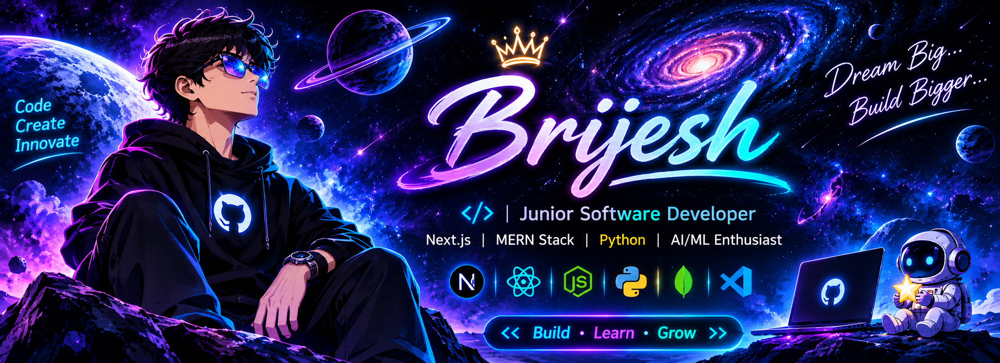

 
---

  

👨‍💻 About Me

const brijesh = {
    role: "Junior Software Developer",
    location: "India 🇮🇳",
    frontend: ["Next.js", "React.js", "JavaScript", "HTML", "CSS"],
    backend: ["Node.js", "Express.js", "Python", "FastAPI"],
    database: ["MongoDB"],
    tools: ["Git", "GitHub", "VS Code"],
    interests: ["AI/ML", "Automation", "Full Stack Development"],
    goal: "Build technology that solves real-world problems"
};

- 💻 Passionate about building modern web applications.
- ⚡ Learning and developing with Next.js and MERN stack.
- 🐍 Using Python for backend development and automation.
- 🤖 Exploring AI, Machine Learning and intelligent applications.
- 🚀 Always learning, experimenting and building new things.

⚡ My Tech Universe

🎨 Frontend Development

⚙️ Backend Development

🗄️ Database & Tools

🚀 Featured Projects

<table>
<tr>
<td width="50%">🤖 AI LinkedIn Post Automation

AI-powered LinkedIn content generation and scheduling.

Focus: Python, FastAPI, Gemini AI, Supabase

</td>
<td width="50%">📞 AI Receptionist Voice Bot

Voice assistant for automated customer support and phone conversations.

Focus: Python, FastAPI, Whisper, Gemini AI

</td>
</tr>
<tr>
<td width="50%">🧠 AI Image Detection

Deep learning project exploring real versus AI-generated image classification.

Focus: Python, Deep Learning, Computer Vision

</td>
<td width="50%">🌐 Full Stack Web Applications

Building responsive, modern web applications and backend APIs.

Focus: Next.js, React, Node.js, MongoDB

</td>
</tr>
</table>📊 GitHub Analytics

 
🐍 My Contribution Journey

🌐 Let's Connect

<!-- Add your LinkedIn profile URL when ready -->

💫 Developer Mindset

"Dream Big. Build Smart. Keep Learning."

